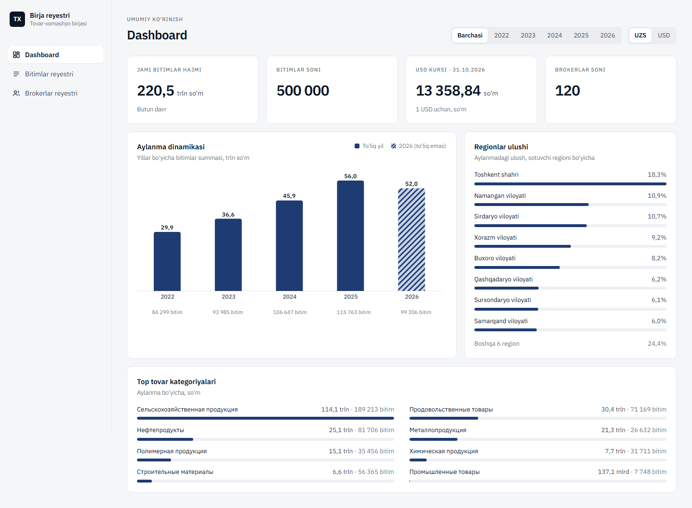
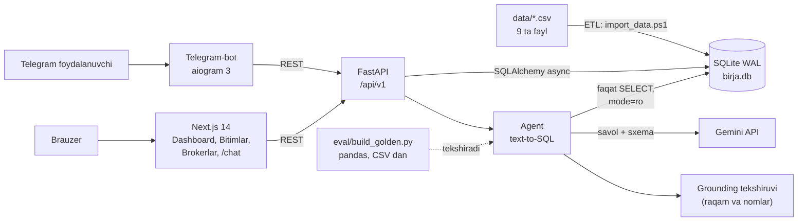

# UZEX Birja AI-agenti — bitimlar reyestri va ma'lumotga asoslangan savol-javob

Tovar-xomashyo birjasi (spot.uzex.uz formatidagi) **500 000 ta bitim** bo'yicha rus va o'zbek tilidagi savollarga
**faqat ma'lumotlar asosida** javob beradigan AI-agent, Telegram-bot va veb-reyestr.

- Telegram-bot: https://t.me/tiu_uzex_ai — ochiq, ro'yxatdan o'tish va admin ruxsati shart emas.
- Repozitoriy: https://github.com/devAsliddin/uzex-birja-ai-agent

Agent har bir javob ostida **manbani** ko'rsatadi: qaysi jadval va filtr ishlatilgani (asos), bajarilgan SQL va natija
qatorlari. Ma'lumotda javob bo'lmasa, raqam yoki nom o'ylab topmaydi, balki ochiq aytadi:

> Bilmayman — ma'lumotlarda bu haqida ma'lumot yo'q.
> Не знаю — в данных нет такой информации.

## Imkoniyatlar

| Qism | Nima qiladi |
|---|---|
| AI-agent (`POST /api/v1/agent/ask`) | Savolni (RU/UZ, lotin/kirill) SQL ga aylantiradi, faqat o'qish rejimidagi bazada bajaradi, javobni faqat natija qatorlaridan yozadi va har bir raqamni deterministik tekshiradi |
| Telegram-bot | Erkin savol + "Manba" bloki (asos, SQL, jadval); `/summary`, `/deal`, `/broker`, `/top_brokers`, `/export` buyruqlari (LLM'siz, to'g'ridan-to'g'ri API) |
| Veb-ilova (Next.js) | Dashboard (aylanma, yillar, oylar, regionlar, kategoriyalar), Bitimlar reyestri (filtr, qidiruv, kartochka, CSV/Excel eksport), Brokerlar reyestri (reyting, profil), AI chat (`/chat`) |
| REST API (FastAPI) | `/deals`, `/deals/{no}`, `/brokers`, `/brokers/{code}`, `/analytics/summary`, `/export/deals`, `/meta/filters`, `/agent/ask` |
| ETL | 9 ta CSV ni SQLite ga idempotent import qiladi (sana, son, valyuta, region normalizatsiyasi) |
| Baholash (`eval/`) | pandas bilan backend koddan mustaqil hisoblangan "oltin" savollar to'plami va agentni avtomatik tekshirish |



## Arxitektura



## Tez ishga tushirish (Windows PowerShell, Docker'siz)

Talablar: Python 3.12+ (3.14 da ham sinalgan), Node.js 22, Gemini API kaliti, Telegram bot tokeni (@BotFather).

1. **Ma'lumot.** Tashkilotchilarning `uzex_spot_data.zip` arxividagi 9 ta CSV ni `data\` papkasiga qo'ying
   (`deals_2022.csv` … `deals_2026.csv`, `contracts.csv`, `participants.csv`, `brokers.csv`, `usd_rates.csv`).
   Ma'lumot repozitoriyga kiritilmagan.

2. **Sozlamalar.** Sirlar faqat `.env` fayllarda saqlanadi (git'ga tushmaydi):
   ```powershell
   copy backend\.env.example backend\.env      # GEMINI_API_KEY=<GEMINI_API_KEY>, SECRET_KEY, ADMIN_PASSWORD
   copy bot\.env.example bot\.env              # BOT_TOKEN=<BOT_TOKEN>
   ```

3. **Backend va import** (birinchi ishga tushirishda `.venv` yaratiladi va paketlar o'rnatiladi):
   ```powershell
   powershell -ExecutionPolicy Bypass -File .\run_backend.ps1   # http://127.0.0.1:8000/docs
   # boshqa oynada, bir marta (~3 daqiqa, qayta ishga tushirish xavfsiz):
   powershell -ExecutionPolicy Bypass -File .\import_data.ps1
   ```

4. **Veb-ilova:**
   ```powershell
   powershell -ExecutionPolicy Bypass -File .\run_frontend.ps1  # http://localhost:3000
   ```

5. **Telegram-bot:**
   ```powershell
   powershell -ExecutionPolicy Bypass -File .\run_bot.ps1        # testlar: .\run_bot.ps1 -Test
   ```

Tekshirish: `curl http://127.0.0.1:8000/health` va
`curl -X POST http://127.0.0.1:8000/api/v1/agent/ask -H "Content-Type: application/json" -d "{\"question\":\"2025-yilda nechta bitim tuzilgan?\"}"`.

## Hujjatlar

- [docs/USAGE.md](docs/USAGE.md) — foydalanish qo'llanmasi: bot, veb-ilova, API (curl), eksport, muammolarni hal qilish.
- [docs/TECHNICAL.md](docs/TECHNICAL.md) — texnik hujjat: arxitektura, ma'lumot modeli, ETL, agent quvuri, xavfsizlik, tezlik, testlar.
- [docs/TEXNOLOGIYALAR.md](docs/TEXNOLOGIYALAR.md) — "Texnologiyalar va usullar" maydoni uchun qisqa matn.
- [API_CONTRACT.md](API_CONTRACT.md) — REST API shartnomasi.
- `data/README.md` — ma'lumotlar formati (RU/UZ).

## Loyiha tuzilmasi

```
backend/    FastAPI, SQLAlchemy, Alembic, ETL (app/services/import_service.py), agent (app/agent/)
frontend/   Next.js 14 + Tailwind + TanStack Query + Recharts
bot/        aiogram 3 Telegram-bot
eval/       mustaqil oltin to'plam (pandas) va baholash skripti
data/       CSV fayllar (repozitoriyda yo'q) va README
docs/       hujjatlar
```

## Краткое описание (RU)

**UZEX Birja AI-agent** — реестр биржевых сделок (500 000 сделок, 2022–2026) и AI-агент, который отвечает на вопросы
на русском и узбекском языках **только по данным**. Доступ: Telegram-бот https://t.me/tiu_uzex_ai (без регистрации)
и веб-приложение (дашборд, реестр сделок, брокеры, чат).

Метод: вопрос → LLM (Gemini) генерирует один SQL-запрос SELECT → запрос выполняется в SQLite в режиме только чтения
(валидация, таймаут, повтор при ошибке) → ответ формируется только из строк результата → детерминированная проверка:
каждое число и название в ответе должно присутствовать в результате или в вопросе, иначе ответ отклоняется. Если данных
нет, агент отвечает «Не знаю — в данных нет такой информации.». Под каждым ответом показан источник: основание,
SQL и строки результата.

Проверка: независимый «золотой» набор вопросов, посчитанный pandas напрямую из CSV (без кода бэкенда), включая
вопросы-ловушки без ответа в данных. Стек: Python, FastAPI, SQLite (WAL), Alembic, aiogram 3, Next.js 14, Tailwind,
Gemini API, pandas, pytest.

Запуск (Windows, без Docker): положить CSV в `data\`, скопировать `backend\.env.example` → `backend\.env`
(`GEMINI_API_KEY`) и `bot\.env.example` → `bot\.env` (`BOT_TOKEN`), затем `run_backend.ps1`, `import_data.ps1`,
`run_frontend.ps1`, `run_bot.ps1`.
