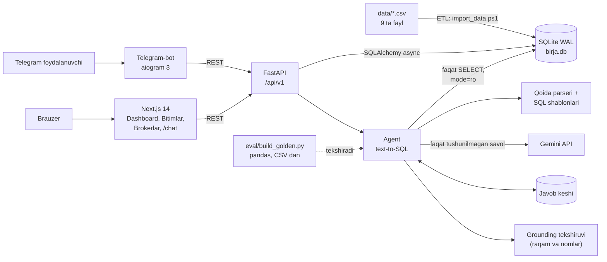

# UZEX Birja AI-agenti — bitimlar reyestri va ma'lumotga asoslangan savol-javob

Tovar-xomashyo birjasi (spot.uzex.uz formatidagi) **500 000 ta bitim** bo'yicha rus va o'zbek tilidagi savollarga
**faqat ma'lumotlar asosida** javob beradigan AI-agent, Telegram-bot va veb-reyestr.

- Telegram-bot: https://t.me/tiu_uzex_ai — ochiq, ro'yxatdan o'tish va admin ruxsati shart emas; ichida Mini App (AI chat, Dashboard, Bitimlar, Brokerlar).
- Veb-ilova: https://45-92-173-47.sslip.io
- Repozitoriy: https://github.com/devAsliddin/uzex-birja-ai-agent

Agent har bir javob ostida **manbani** ko'rsatadi: qaysi jadval va filtr ishlatilgani (asos), bajarilgan SQL va natija
qatorlari. Ma'lumotda javob bo'lmasa, raqam yoki nom o'ylab topmaydi, balki ochiq aytadi:

> Bilmayman — ma'lumotlarda bu haqida ma'lumot yo'q.
> Не знаю — в данных нет такой информации.

## Imkoniyatlar

| Qism | Nima qiladi |
|---|---|
| AI-agent (`POST /api/v1/agent/ask`) | Gibrid: qoida asosidagi parser + parametrli SQL shablonlari (LLM'siz), tushunilmagan savollar uchun Gemini text-to-SQL; faqat o'qish rejimidagi baza, raqamlar natija qatorlaridan kod bilan qo'yiladi, deterministik grounding tekshiruvi, doimiy javob keshi |
| Telegram-bot + Mini App | Erkin savol + "Manba" bloki (asos, SQL, jadval); `/summary`, `/deal`, `/broker`, `/top_brokers`, `/export` buyruqlari (LLM'siz, to'g'ridan-to'g'ri API) |
| Veb-ilova (Next.js) | Dashboard (aylanma, yillar, oylar, regionlar, kategoriyalar), Bitimlar reyestri (filtr, qidiruv, kartochka, CSV/Excel eksport), Brokerlar reyestri (reyting, profil), AI chat (`/chat`) |
| REST API (FastAPI) | `/deals`, `/deals/{no}`, `/brokers`, `/brokers/{code}`, `/analytics/summary`, `/export/deals`, `/meta/filters`, `/agent/ask` |
| ETL | 9 ta CSV ni SQLite ga idempotent import qiladi (sana, son, valyuta, region normalizatsiyasi) |
| Baholash (`eval/`) | pandas bilan backend koddan mustaqil hisoblangan oltin to'plam (78 savol) va parafraz to'plam (60 savol), avtomatik baholash |

## Natijalar

| To'plam | Natija | Aniq javoblar | Javobsiz (no_data) | Gallyutsinatsiya |
|---|---|---|---|---|
| Oltin, 78 savol | 76/78 (97,4%) | 64/66 | 12/12 | 0 |
| Parafraz (yangi, ko'rilmagan), 60 savol | 60/60 (100%) | 50/50 | 10/10 | 0 |

Oltin to'plamdagi 2 ta "xato" — oltin to'plamning o'zidagi AI-92 nomi yozilishi bilan bog'liq xato (qo'lda tekshirilgan).
Javob vaqti: p50 ~75 ms, p95 ~0,5 s; 20 ta parallel so'rov — hammasi muvaffaqiyatli, p95 492 ms.


## Arxitektura



## Tez ishga tushirish (Windows PowerShell, Docker'siz)

Talablar: Python 3.12+ (3.14 da ham sinalgan), Node.js 22, Gemini API kaliti, Telegram bot tokeni (@BotFather).

1. **Ma'lumot.** Tashkilotchilarning `uzex_spot_data.zip` arxividagi 9 ta CSV ni `data\` papkasiga qo'ying
   (`deals_2022.csv` … `deals_2026.csv`, `contracts.csv`, `participants.csv`, `brokers.csv`, `usd_rates.csv`).
   Ma'lumot repozitoriyga kiritilmagan.

2. **Sozlamalar.** Sirlar faqat `.env` fayllarda saqlanadi (git'ga tushmaydi):
   ```powershell
   copy backend\.env.example backend\.env      # GEMINI_API_KEY=<GEMINI_API_KEY>, SECRET_KEY, ADMIN_PASSWORD
   # agent zanjiri: AI_MODEL_CHAIN=rules,gemini:gemini-3.5-flash,gemini:gemini-3.5-flash-lite,gemini:gemini-3.1-flash-lite
   # (faqat "rules" bo'lsa, agent kalitsiz va internetsiz ishlaydi)
   copy bot\.env.example bot\.env              # BOT_TOKEN=<BOT_TOKEN>
   ```

3. **Backend va import** (birinchi ishga tushirishda `.venv` yaratiladi va paketlar o'rnatiladi):
   ```powershell
   powershell -ExecutionPolicy Bypass -File .\run_backend.ps1   # http://127.0.0.1:8000/docs
   # boshqa oynada, bir marta (~3 daqiqa, qayta ishga tushirish xavfsiz):
   powershell -ExecutionPolicy Bypass -File .\import_data.ps1
   ```

4. **Veb-ilova:**
   ```powershell
   powershell -ExecutionPolicy Bypass -File .\run_frontend.ps1  # http://localhost:3000
   ```

5. **Telegram-bot:**
   ```powershell
   powershell -ExecutionPolicy Bypass -File .\run_bot.ps1        # testlar: .\run_bot.ps1 -Test
   ```

Tekshirish: `curl http://127.0.0.1:8000/health` va
`curl -X POST http://127.0.0.1:8000/api/v1/agent/ask -H "Content-Type: application/json" -d "{\"question\":\"2025-yilda nechta bitim tuzilgan?\"}"`.

## Hujjatlar

- [docs/USAGE.md](docs/USAGE.md) — foydalanish qo'llanmasi: bot, veb-ilova, API (curl), eksport, muammolarni hal qilish.
- [docs/TECHNICAL.md](docs/TECHNICAL.md) — texnik hujjat: arxitektura, ma'lumot modeli, ETL, agent quvuri, xavfsizlik, tezlik, testlar.
- [docs/TEXNOLOGIYALAR.md](docs/TEXNOLOGIYALAR.md) — "Texnologiyalar va usullar" maydoni uchun qisqa matn.
- [API_CONTRACT.md](API_CONTRACT.md) — REST API shartnomasi.
- `data/README.md` — ma'lumotlar formati (RU/UZ).

## Loyiha tuzilmasi

```
backend/    FastAPI, SQLAlchemy, Alembic, ETL (app/services/import_service.py), agent (app/agent/)
frontend/   Next.js 14 + Tailwind + TanStack Query + Recharts
bot/        aiogram 3 Telegram-bot
eval/       mustaqil oltin to'plam (pandas) va baholash skripti
data/       CSV fayllar (repozitoriyda yo'q) va README
docs/       hujjatlar
```

## Краткое описание (RU)

**UZEX Birja AI-agent** — реестр биржевых сделок (500 000 сделок, 2022–2026) и AI-агент, который отвечает на вопросы
на русском и узбекском языках **только по данным**. Доступ: Telegram-бот https://t.me/tiu_uzex_ai (без регистрации)
(с Mini App) и веб-приложение https://45-92-173-47.sslip.io (дашборд, реестр сделок, брокеры, чат).

Метод — гибридный агент: правиловый парсер распознаёт вопрос и выполняет параметризованный SQL-шаблон без вызова LLM;
только нераспознанные вопросы уходят в Gemini (один JSON-вызов: SQL и шаблон ответа, числа подставляются кодом из строк
результата). SQL выполняется в SQLite только для чтения (один SELECT, таймаут), затем детерминированная проверка: каждое
число, код и название в ответе должно быть в результате или в вопросе. Ошибка LLM — ответ «Не знаю». Кэш ответов. Если данных
нет, агент отвечает «Не знаю — в данных нет такой информации.». Под каждым ответом показан источник: основание,
SQL и строки результата.

Проверка: эталонные ответы посчитаны pandas напрямую из CSV (без кода бэкенда). Золотой набор 78 вопросов — 76/78
(97,4%; 2 промаха — ошибки самого набора в написании АИ-92), вопросы-ловушки без ответа 12/12; новый набор перефразировок
60 вопросов — 60/60; галлюцинаций 0; p50 ~75 мс, p95 ~0,5 с. Стек: Python, FastAPI, SQLite (WAL), Alembic, aiogram 3, Next.js 14, Tailwind,
Gemini API, pandas, pytest.

Запуск (Windows, без Docker): положить CSV в `data\`, скопировать `backend\.env.example` → `backend\.env`
(`GEMINI_API_KEY`) и `bot\.env.example` → `bot\.env` (`BOT_TOKEN`), затем `run_backend.ps1`, `import_data.ps1`,
`run_frontend.ps1`, `run_bot.ps1`.
