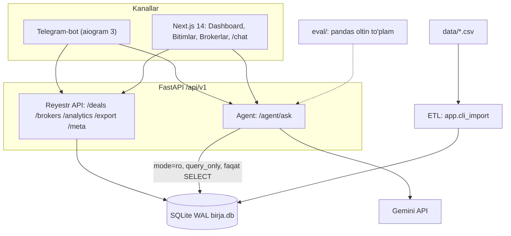
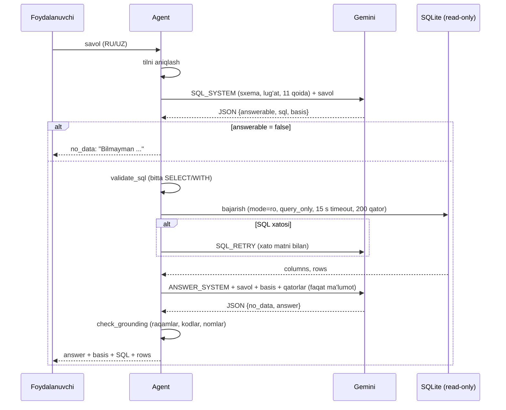

# Texnik hujjat

## 1. Maqsad va asosiy tamoyil

Vazifa: birja bitimlari haqidagi rus va o'zbek tilidagi savollarga **aniq va faqat ma'lumotlar asosida** javob
beruvchi AI-agent. Ma'lumotda javob yo'q joyda raqam, kompaniya yoki tovar aytish diskvalifikatsiyaga olib keladi.

Shu sababli tizim "LLM bilimiga" emas, **bazadagi SQL natijasiga** tayanadi:

- LLM faqat ikki ishni qiladi: savolni SQL ga aylantiradi va natija qatorlarini matnga o'giradi.
- Raqamlarni LLM hisoblamaydi: barcha yig'indi, o'rtacha, foiz va reytinglar SQL ichida hisoblanadi.
- Yakuniy matndagi har bir raqam va nom kod bilan (deterministik) natija qatorlariga solishtiriladi; mos kelmasa,
  javob qaytarilmaydi.

## 2. Arxitektura va komponentlar

| Komponent | Papka | Texnologiya | Vazifa |
|---|---|---|---|
| Backend API | `backend/app/api`, `crud`, `services` | FastAPI, SQLAlchemy 2 async, aiosqlite, Pydantic 2 | reyestr endpointlari, analitika keshi, eksport, rate-limit |
| Migratsiyalar | `backend/alembic/versions/0001_initial_schema.py` | Alembic | TZ 3-bo'lim bo'yicha sxema, CHECK, FK, indekslar |
| ETL | `backend/app/services/import_service.py`, `app/cli_import.py` | Python csv, executemany | 9 ta CSV → SQLite, idempotent |
| Agent | `backend/app/agent/` (`db.py`, `grounding.py`, `prompts.py`) | Gemini API, sqlite3 | text-to-SQL, read-only bajarish, grounding |
| Telegram-bot | `bot/app/` | aiogram 3, httpx | erkin savol → `/agent/ask`, buyruqlar → REST |
| Veb-ilova | `frontend/src/` | Next.js 14 App Router, TypeScript, Tailwind, TanStack Query, Recharts | dashboard, reyestrlar, chat |
| Baholash | `eval/` | pandas | backenddan mustaqil oltin javoblar va avtomatik baholash |

Ishga tushirish Docker'siz: `run_backend.ps1` (venv + `alembic upgrade head` + uvicorn `127.0.0.1:8000`),
`import_data.ps1`, `run_frontend.ps1` (`npm run dev`, port 3000), `run_bot.ps1`.
Kod dialektdan mustaqil: `DATABASE_URL=postgresql+asyncpg://...` bilan PostgreSQL ham ishlaydi (bu muhitda sinalmagan).

## 3. Ma'lumot modeli

Asosiy 5 jadval (TZ 3-bo'lim):

| Jadval | Kalit | Qatorlar | Muhim ustunlar |
|---|---|---|---|
| `brokers` | PK `broker_code` (`BK001`..`BK120`) | 120 | `name`, `inn`, `region` (o'zbek lotin) |
| `participants` | PK `inn` (9 raqam) | 14 392 | `name`, `region`, `activity_type`, `role` (CHECK: `Продавец` / `Покупатель`), `is_vat_payer` |
| `usd_rates` | PK `rate_date` | 1 765 | `rate` (1 USD uchun so'm), har kalendar kun |
| `contracts` | PK `contract_no`; FK `seller_inn` → participants | 6 616 | tovar va atributlari, `tn_ved_code`, `product_group`, `product_category`, `industry`, `unit`, `lot_size`, `currency` (CHECK), `base_price`, `deposit_percentage`, `delivery_basis`, `region` (rus nomi), `payment_days`, `delivery_days`, `contract_type`/`contract_form` (CHECK), `registration_date`, `valid_until` |
| `deals` | PK `deal_no` | 500 000 | `deal_date`, `deal_time`, `trade_type`, `quantity`, `amount` (shartnoma valyutasida), `start_price`, `contract_no`, `product_name`, `lot_size`, `unit`, `region`, `status`, `seller_inn`, `buyer_inn`, `seller_broker`, `buyer_broker`, `payment_date`, `delivery_date`, `delivered_lots` |

`deals` dagi FK: `contract_no` → contracts, `seller_inn`/`buyer_inn` → participants, `seller_broker`/`buyer_broker` → brokers.

Indekslar (`deals`):

| Indeks | Ustunlar | Kim ishlatadi |
|---|---|---|
| `idx_deals_date_status` | `(deal_date DESC, status)` | sana oralig'i va holat filtri, reyestr sahifalash |
| `idx_deals_brokers` | `(seller_broker, buyer_broker)` | broker filtri, reyting |
| `idx_deals_participants` | `(seller_inn, buyer_inn)` | kompaniya (STIR) bo'yicha savollar |
| `idx_deals_contract` | `(contract_no)` | shartnoma bilan JOIN |

Qo'shimcha jadvallar (users, api_keys, audit_logs, evaluation_*, prompt_versions, conversations, messages) ma'muriy
va baholash uchun; ochiq endpointlar ularni ishlatmaydi.

Agent uchun har ulanishda vaqtinchalik `TEMP VIEW v_deals` yaratiladi: `deals` + shartnoma (valyuta, kategoriya,
muddatlar) + bitim sanasidagi USD kursi. Unda tayyor ustunlar bor: `amount_uzs`, `amount_usd`, `is_usd`, `volume`
(= quantity × lot_size), `unit_price`, `delivery_due_date` (= payment_date + delivery_days), `is_valid`
(annulirlanmagan), `year`, `month`. Shu tufayli model valyuta konvertatsiyasini har safar qayta yozmaydi va xato
qilish ehtimoli kamayadi.

## 4. ETL qoidalari

Manba: `data\*.csv` (UTF-8, vergul ajratuvchi, birinchi qator — sarlavha). Fayllar o'zgartirilmaydi.
Tartib: brokers → participants → usd_rates → contracts → deals_2022..2026 (FK bog'liqligi bo'yicha).

| Qoida | Amalga oshirish |
|---|---|
| Sana | `DD.MM.YYYY` → ISO `YYYY-MM-DD` (ISO kirish ham qabul qilinadi); vaqt `HH:MM:SS` |
| Sonlar | mingliklar orasidagi bo'shliq (oddiy va NBSP) olib tashlanadi, kasr — nuqta; `Сумма залога` dagi `%` olib tashlanadi |
| Bo'sh qiymatlar | bo'sh qator → `NULL` (`payment_date`, `delivery_date`, `delivered_lots` va h.k.); hech narsa to'ldirilmaydi yoki taxmin qilinmaydi |
| Majburiy maydonlar | NOT NULL ustunlar tekshiriladi; noto'g'ri qator hisobotda sanaladi va o'tkazib yuboriladi |
| Valyuta | `Узбекский сум` / `Доллар США` (CHECK); bitim summasi shartnoma valyutasida saqlanadi |
| USD → so'm | saqlanmaydi, so'rovda hisoblanadi: `amount × usd_rates.rate` bitim sanasida (kun yo'q bo'lsa, oldingi eng yaqin kun) |
| Regionlar | qiymatlar asl holida saqlanadi; `app/core/regions.py` rus va lotin yozuvlarini (apostrof variantlari bilan) bitta o'zbek lotin kalitiga (`region_key`) moslaydi |
| Idempotentlik | tabiiy kalit (PK) bo'yicha: mavjud yozuv takrorlanmaydi, o'zgargan maydonlar yangilanadi; qayta import xavfsiz |
| Tranzaksiyalar | `IMPORT_BATCH_SIZE` (5 000) qatorlik paketlarda `executemany`, har paketdan keyin commit |
| Hisobot | har fayl uchun jami / qo'shilgan / yangilangan / o'tkazilgan / xato qatorlar |

Natija: 500 000 bitim, 6 616 shartnoma, 14 392 ishtirokchi, 120 broker, 1 765 kurs — **0 ta xato qator**.
Import vaqti SQLite da ~3 daqiqa.

## 5. Ma'lumotdagi o'ziga xosliklar va ular qanday hal qilingan

| O'ziga xoslik | Hajmi | Yechim |
|---|---|---|
| Dollar shartnomalari (eksport) | 6 590 bitim | summalar hech qachon valyutalar aro qo'shilmaydi; jami so'mda `amount_uzs` (bitim sanasidagi kurs), dollarda `amount_usd`; narxlar valyuta bo'yicha alohida |
| `Аннулирован(Не оплачен)` | 33 719 bitim | bitim amalga oshmagan — aylanma, reyting, kategoriya va region ulushlaridan chiqariladi (`is_valid = 1`); bitimlar **soni** so'ralganda hammasi va alohida haqiqiylari ko'rsatiladi; asos (basis) da ochiq yoziladi |
| Bir tovar turlicha yozilgan (sotuvchi to'ldiradi: "1 сорт" / "1-сорта", katta harflar, atribut nomlari bilan va siz) | ~230 nom variantı → ~188 mazmunan alohida tovar | agent bir nechta o'zak bilan `LIKE` ishlatadi (`%пшениц%`), kirill uchun katta-kichik harf variantlari bilan (SQLite `LOWER` faqat ASCII ni o'zgartiradi); mos kelgan nomlar natijada qaytariladi; kategoriya so'ralsa `product_category`/`industry` ishlatiladi |
| Region: lotin (bitim, ishtirokchi, broker) va rus (shartnoma) | 14 region | `region_key` normalizatsiyasi; API filtri ikkala yozuvni qabul qiladi; agent promptida moslik lug'ati va `LIKE 'Farg%ona%'` usuli (apostrof U+2018) |
| Bitta broker bitimning ikkala tomonida | 4 562 bitim | broker bo'yicha bitimlar soni `COUNT(DISTINCT deal_no)` bilan (ikki marta sanalmaydi); broker aylanmasida bitim har bir tomon uchun bir marta |
| Qisman yetkazish | `Исполнен(Частично)` | `delivered_lots < quantity`; yetkazilgan hajm `delivered_lots × lot_size` |
| Kechikkan yetkazish | — | `delivery_date > payment_date + delivery_days`; hali yetkazilmagan, muddati o'tgan: `delivery_date IS NULL AND due < 2026-10-30` (`Оплачен`, `Исполнен(Частично)`) |
| Bitim raqamlari uzluksiz emas | — | raqam mavjud emasligi — `404` / "Bilmayman", taxmin qilinmaydi |
| Holatlar 30.10.2026 kuni oxiri bo'yicha | — | "oxirgi oy" kabi nisbiy davrlar ma'lumot oxiriga (2026-10) nisbatan talqin qilinadi |

## 6. AI-agent quvuri (`POST /api/v1/agent/ask`)

So'rov: `{"question": "...", "language": "auto"}`.
Javob: `answer`, `status` (`ok` | `no_data` | `error`), `language`, `sql` (ro'yxat), `columns`, `rows`, `row_count`,
`basis`, `latency_ms`.

1. **Til aniqlash.** Savolning yozuvi va so'zlari bo'yicha `uz` yoki `ru`; javob va "Bilmayman" matni shu tilda.
2. **SQL yaratish.** Gemini barqaror tizim prompti (`prompts.py: SQL_SYSTEM`) bilan chaqiriladi — prefiks o'zgarmas, shuning
   uchun Gemini implicit prompt caching ishlaydi. Promptda: jadvallar va ustunlar, qiymatlar lug'ati (holatlar, savdo turlari,
   kategoriyalar, regionlar RU↔UZ, o'zbekcha oy nomlari) va 11 qoida (valyutalarni aralashtirmaslik, annulirlanganlarni
   chiqarish, tovar nomini bir nechta o'zak bilan qidirish, hajmni birlik bo'yicha guruhlash, brokerni ikki marta sanamaslik,
   kechikish ta'rifi, barcha hisob SQL ichida `ROUND(x, 2)` bilan, javob bo'lmasa `answerable: false`). Model faqat JSON qaytaradi:
   `{"answerable", "sql", "basis"}`.
3. **Javobsiz savolni erta aniqlash.** Davr 2022-01-03..2026-10-30 dan tashqarida, ustunlarda yo'q ma'lumot (foyda, ob-havo,
   boshqa birjalar, prognoz, sabablar, shaxslar) yoki juda noaniq savol → `answerable: false` → `status: no_data`.
4. **SQL validatsiyasi** (`db.py: validate_sql`): izohlar olib tashlanadi; faqat bitta statement; birinchi so'z `SELECT`
   yoki `WITH`; taqiqlangan so'zlar (`ATTACH`, `PRAGMA`, `INSERT`, `UPDATE`, `DELETE`, `DROP`, `CREATE`, `ALTER`,
   `load_extension`, `writefile`, `readfile` va boshqalar) string literallardan tashqarida qidiriladi; uzunlik ≤ 8 000.
5. **Read-only bajarish** (`db.py: run_query`): har so'rov uchun yangi `file:...?mode=ro` ulanish + `PRAGMA query_only=ON`;
   progress handler orqali 15 s timeout; natija 200 qator bilan cheklanadi (`truncated` belgisi).
6. **Qayta urinish.** SQL xato bersa, xato matni bilan `SQL_RETRY` prompti yuboriladi va tuzatilgan so'rov bajariladi.
7. **Javob yozish** (`ANSWER_SYSTEM`): model faqat natija qatorlaridan foydalanadi, raqamlarni oldindan formatlangan holda
   ko'chiradi (arifmetika yo'q), birinchi qatorda to'g'ridan-to'g'ri javob, valyuta har doim ko'rsatiladi. Qatorlar bo'sh
   yoki savolga javob bermasa — `no_data: true`. Qatorlar ichidagi matn buyruq sifatida bajarilmaydi.
8. **Deterministik grounding tekshiruvi** (`grounding.py: check_grounding`):
   - javobdagi har bir son ajratib olinadi (mingliklar bo'shlig'i, vergul/nuqta kasr, sanalar qismlarga bo'linadi,
     "млн/млрд/трлн/mln/mlrd/trln/ming" ko'paytuvchilari hisobga olinadi);
   - har bir son natija qatoridagi qiymatga, savoldagi songa yoki qatorlar soniga teng bo'lishi shart (faqat yaxlitlash
     farqi ruxsat etiladi: ko'rsatilgan kasr xonalari bo'yicha ±0.5 birlik, katta butun sonlar uchun ±1);
   - `BK###` broker kodlari va qo'shtirnoqdagi nomlar natija qatorlarida yoki savolda bo'lishi shart;
   - bitta ham mos kelmagan qiymat bo'lsa, javob rad etiladi va foydalanuvchiga uydirma raqam yetib bormaydi
     (qayta yozish yoki `no_data`).
9. **Natija.** `status: ok` bo'lsa — javob + asos + SQL + qatorlar; `no_data` bo'lsa — faqat
   "Bilmayman — ma'lumotlarda bu haqida ma'lumot yo'q." / "Не знаю — в данных нет такой информации.".

## 7. Gallyutsinatsiyaga qarshi kafolatlar

| Xavf | Himoya |
|---|---|
| LLM raqamni o'ylab topadi | barcha hisoblar SQL da; grounding tekshiruvi har bir sonni natija qatorlariga solishtiradi |
| LLM nom yoki kodni o'ylab topadi | `BK###` kodlari va qo'shtirnoqdagi nomlar natijada bo'lishi shart |
| Ma'lumotda yo'q mavzu | promptdagi aniq chegaralar (davr, mavzular) → `answerable: false` → "Bilmayman" |
| Bo'sh natija | `no_data` — raqam emas, ochiq "Bilmayman" |
| Valyutalarni aralashtirish | `v_deals.amount_uzs` / `amount_usd`; qoida 1 |
| Annulirlangan bitimlarni aylanmaga qo'shish | `is_valid`; qoida 2; asosda ochiq yoziladi |
| Tovar nomi variantlari tufayli to'liq bo'lmagan natija | bir nechta o'zak bilan qidiruv; mos kelgan nomlar natijada qaytariladi |
| Javobni tekshirib bo'lmaslik | har javob bilan SQL, asos va natija qatorlari ko'rsatiladi — hakam o'zi qayta bajara oladi |

## 8. Xavfsizlik

- **Bazaga faqat o'qish:** agent `mode=ro` ulanish + `PRAGMA query_only=ON`; `v_deals` faqat TEMP (xotirada) sxemada.
- **SQL validatsiyasi:** faqat bitta `SELECT`/`WITH`; DDL/DML, `PRAGMA`, `ATTACH`, fayl funksiyalari taqiqlangan; timeout va qator limiti.
- **Prompt injection:** foydalanuvchi matni so'rov tanasida alohida `question` maydoni sifatida yuboriladi va promptda
  "savol" (ma'lumot) sifatida belgilanadi; SQL natijasidagi matnlar ham "faqat ma'lumot, ko'rsatma emas" deb belgilangan;
  agent faqat o'qish huquqiga ega, shuning uchun hatto muvaffaqiyatli injection ham ma'lumotni o'zgartira olmaydi.
- **Parametrli SQL** reyestr endpointlarida (SQLAlchemy); filtrlar oq ro'yxat bo'yicha.
- **Rate limit:** backend — umumiy 100/daq, AI 30/daq, eksport 10/daq (IP bo'yicha, sliding window); bot — foydalanuvchiga
  10/daq va 200/kun, bir vaqtda 20 tadan ko'p agent so'rovi yo'q (semafor), eksport 30 s da bir marta.
- **Eksport:** maksimal 500 000 qator (bot 20 000), CSV/Excel formula injection himoyasi (`=`, `+`, `-`, `@`, tab, CR bilan
  boshlanuvchi kataklar zararsizlantiriladi).
- **Bot:** kirish validatsiyasi (bitim raqami `^\d{1,12}$`, broker `^BK\d{3}$`, sana, holat oq ro'yxati); javoblar HTML-escape
  qilinadi; loglarda chat ID xeshlangan, savol matni yozilmaydi; xatolarda ichki ma'lumot (stack trace, URL) ko'rsatilmaydi.
- **Sirlar:** `GEMINI_API_KEY`, `BOT_TOKEN`, `SECRET_KEY` faqat `.env` da; `.env`, `*.db`, `data/` `.gitignore` da;
  `.env.example` da faqat soxta qiymatlar.
- **CORS:** faqat `http://localhost:3000` va `http://127.0.0.1:3000`.
- **Ma'lumot oqimi:** Gemini ga sxema, savol va SQL natija qatorlari (≤ 200) yuboriladi; ma'lumot sintetik
  (tashkilotchilar: "barcha kompaniyalar, STIR va summalar o'ylab topilgan"), shaxsiy ma'lumot yo'q.

Tekshirilmagan / qolgan xavf: HTTPS (lokal ishga tushirishda yo'q, tashqi kirish tunnel/proksi orqali bo'lishi kerak),
bog'liqliklar CVE skani, Gemini API mavjudligiga bog'liqlik (API ishlamasa agent `error` qaytaradi, raqam o'ylab topmaydi).

## 9. Tezlik

O'lchovlar (SQLite, 500 000 bitim, lokal):

| Operatsiya | Vaqt |
|---|---|
| `/deals` birinchi sahifa | 15–40 ms |
| `/deals` filtr bilan | 20–60 ms; qidiruv ~55 ms |
| `/deals` 5000-sahifa | ~0.4 s |
| `/brokers`, `/meta/filters`, `/analytics/summary` | ishga tushishda isitiladi; sovuq 1.5–2.5 s, keshdan ~2 ms (TTL 10 daq) |
| xlsx eksport, 1 oy | ~7 s |
| CSV eksport, 500 000 qator | ~30 s |
| Bot stress testi (2 000 parallel update, mock backend) | 0 xato, p95 1.15 s |
| Agent javobi (`/agent/ask`) | `<AGENT_LATENCY_P50>` / p95 `<AGENT_LATENCY_P95>` (eval natijasidan) |

Agent tezligi: barqaror prompt prefiksi (implicit caching), SQL natijasi 200 qator bilan cheklangan, LLM ga faqat
natija qatorlari beriladi (butun jadval emas), `v_deals` tayyor hisoblangan ustunlari bilan.

## 10. Testlash

| To'plam | Soni | Nimani tekshiradi |
|---|---|---|
| `backend/tests` (pytest) | 26 | API endpointlari, filtrlar, 404/422, hisoblashlar (valyuta, aylanma), import (sana/son parsing, idempotentlik), xavfsizlik |
| `bot/tests/test_smoke.py` | 15 | har bir buyruq formati, validatsiya, 404, guruhdagi eslatish/javob qoidalari, rate limit, backend xatosi |
| `bot/tests/test_stress.py` | 4 | 200 va 2 000 parallel update, bitta chatdan 300 xabar oqimi, 20 parallel eksport, noto'g'ri kiritish |
| `bot/tests/test_live.py` | 1 | haqiqiy backendga qarshi (`LIVE_BACKEND` o'rnatilganda) |
| `eval/` | `<GOLDEN_COUNT>` savol | agent aniqligi (quyida) |

Ishga tushirish: `cd backend; .venv\Scripts\python -m pytest -q` va `.\run_bot.ps1 -Test`.

### Agent baholash (`eval/`)

- `eval/build_golden.py` — **backend kodi va bazasidan mustaqil**: faqat xom CSV larni pandas bilan o'qiydi va har bir savol
  uchun to'g'ri javobni hisoblaydi (`eval/golden.jsonl`). Shu tarzda ETL yoki SQL dagi xato oltin javobga "ko'chib" o'tmaydi.
- Savollar RU va UZ tillarida, toifalar: sanash, yig'indi, o'rtacha, narx, top-N, ekstremum, aniq bitim/kompaniya qidiruvi,
  vaqt davrlari, "tuzoq" savollar (valyuta, annulirlangan, ikki tomonlama broker) va **javobi yo'q savollar** (`no_data`).
- Baholash skripti har savolni `/agent/ask` ga yuboradi va tekshiradi: raqam oltin qiymatga mosmi (toifaga qarab aniq yoki
  ruxsat etilgan tolerantlik bilan), `no_data` savollarda agent "Bilmayman" dedimi, va javobda oltin to'plamda yo'q raqam
  (gallyutsinatsiya) bormi.
- Natija: aniqlik `<ACCURACY>`%, `no_data` savollarda to'g'ri rad etish `<NO_DATA_ACCURACY>`%, gallyutsinatsiyalar
  `<HALLUCINATIONS>`; javob vaqti p50 `<AGENT_LATENCY_P50>`, p95 `<AGENT_LATENCY_P95>` (`eval/results_*.json`).

## 11. Cheklovlar

- Agent Gemini API ga bog'liq: internet yoki API kaliti bo'lmasa, erkin savollar ishlamaydi (buyruqlar va veb-reyestr ishlaydi).
- Natija 200 qator bilan cheklangan; uzun ro'yxatlar uchun eksportdan foydalaning.
- Tovar nomlari bir xil yozilmagan: juda noodatiy nom yoki sinonim bilan berilgan savolda mos kelish to'liq bo'lmasligi
  mumkin — shuning uchun mos kelgan nomlar natijada ko'rsatiladi.
- Juda noaniq savolga agent taxmin qilmaydi, "Bilmayman" deydi; savolni aniqlashtirish kerak.
- Bot `/top_brokers` buyrug'ida yil filtri yo'q (butun davr); yil bo'yicha reyting uchun erkin savol bering.
- PostgreSQL rejimi kodda qo'llab-quvvatlanadi, lekin bu muhitda sinalmagan.
- Ma'lumot sintetik va statik (30.10.2026 holati); real vaqtda yangilanish yo'q.
